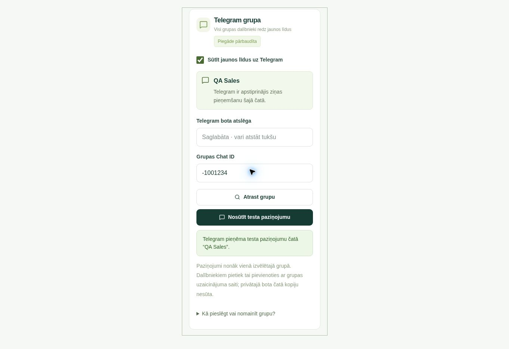
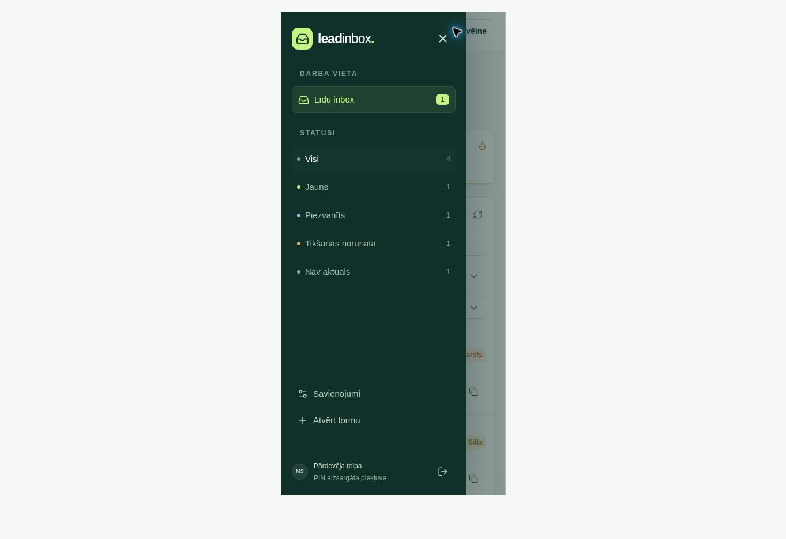
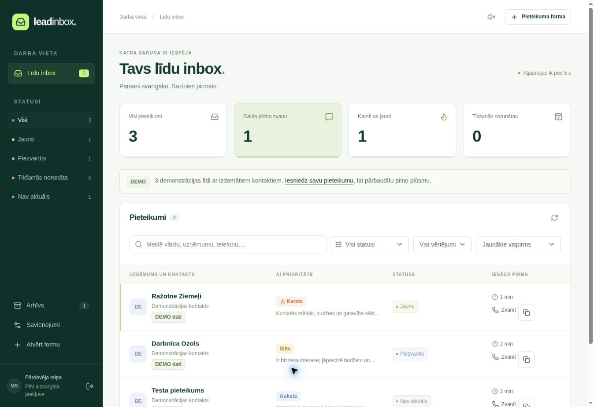

# Sharpify Lead Inbox — prasības un pārbaude

Izstrādāja Mārcis Sidorčiks ar AI palīdzību. Dzīvā pārbaude veikta 2026. gada 19. novembrī. Zemāk norādītie 0,813/1,225 sekunžu mērījumi veikti esošajā serverī pirms Vercel vārtejas pievienošanas; tie nav atsevišķs Vercel ātruma mērījums.

## Publiskās saites

- [Pārdevēja demonstrācija un aktuālais servera statuss](https://sharpify-lead-inbox-psybele.vercel.app/demo)
- [Pieteikuma forma](https://sharpify-lead-inbox-psybele.vercel.app/)
- [PIN aizsargāts inbox](https://sharpify-lead-inbox-psybele.vercel.app/inbox)
- [Pirmkoda lejupielāde](https://sharpify-lead-inbox-psybele.vercel.app/kods)

PIN vērtētājs saņem atsevišķi. API atslēgas, sesijas un pieteikumu datubāze pirmkodā nav iekļautas.

## Obligātās prasības

| Prasība | Īstenojums | Pārbaude |
| --- | --- | --- |
| Publiska forma ar 7 laukiem | Vārds, telefons, e-pasts, uzņēmums, nozare, mēneša apgrozījums, mērķis; servera un pārlūka validācija. | Publiskajā pārlūkā aizpildīta un iesniegta forma; saņemts apstiprinājums. Iepriekš pārbaudīts 390 px izkārtojums. |
| Dati saglabājas | Cloudflare D1; dati tiek saglabāti pirms AI un paziņojumu izsaukumiem. | Testa ieraksts un tā izmaiņas atkārtoti nolasītas ar atsevišķiem servera pieprasījumiem. |
| PIN inbox un 4 statusi | Servera autorizācija, HttpOnly sesija; jaunākie līdi augšā, automātiska atjaunošanās ik pēc 5 s. | Jaunais testa līds ir pirmais; pārbaudītas visas statusu pārejas un piezīmju saglabāšana. |
| Ārējs paziņojums mazāk nekā minūtē | Telegram Bot API; papildus neatkarīgs Resend e-pasts. | Telegram pieņēma testa līda ziņu 1,225 s pēc līda izveides. |
| Īsts AI vērtējums | Groq API, `openai/gpt-oss-20b`, stingra JSON shēma; Karsts/Silts/Auksts un iemesls. | Groq atgrieztais `Karsts`, iemesls un sarunas sākums saglabāti 0,813 s pēc līda izveides. |

Ātruma dati ir viena sekmīga testa mērījums serverī, nevis garantēts maksimālais laiks. Inbox pārlūkā datus nolasa ik pēc 5 s. Telegram laiks norāda API pieņemšanu, nevis ziņas izlasīšanu.

## Papildu funkcijas

- Zvana poga ar normalizētu `tel:` adresi un numura kopēšanu.
- Līda vecums minūtēs, meklēšana, statusu un prioritātes filtri, kārtošana.
- AI sarunas sākuma jautājums, kopēšana un pārdevēja piezīmes.
- Katras ārējās apstrādes fāzes stāvoklis un atkārtošana no inbox.
- Telegram un e-pasts var darboties vienlaikus, nepārtraucot otru kanālu viena kļūmes dēļ.

Zvana URI un mobilais panelis ir pārbaudīti. Attālinātā pārlūka protokola ierobežojums neļauj apliecināt īstā tālruņa zvana lietotnes atvēršanu; to pārbauda fiziskā telefonā. Ja lietotnes iebūvētais pārlūks neatver zvanu, atver saiti parastajā pārlūkā vai nokopē numuru.

## Testa pierādījumi

Publiski iesniegtā QA līda ID: `deeff6d9-8b5a-4666-b6f4-dc158a6e7f1c`. Nosaukums: `QA nodošana 19.11`; izmantoti izdomāti kontakti. Pēc pārbaudes statuss ir `Nav aktuāls` un pievienota piezīme nesazināties.

E-pasta iestatījumi tika saglabāti jau pēc šā sākotnējā testa līda iesniegšanas. Pēc tam ar to pašu līdu pārbaudīta e-pasta atkārtošana: Resend atgrieza pieņemtas ziņas ID. AI un Telegram netika sūtīti atkārtoti. Šis e-pasta tests nav sākotnējā iesnieguma ātruma mērījums. Toreiz tika izmantots Resend testa sūtītājs. Vēlāk pieslēgts sūtītājs no `lead.psybele.com`; aktuālā gala pārbaude ir aprakstīta tālāk.

## Automātiskā pārbaude

Pārbaudītajam risinājumam iziet 60 testi, TypeScript pārbaude un produkcijas build. Komandas:

```bash
npm test
npm run check
npm run build
```

Testi ietver autorizāciju, PIN minēšanas limitu, saglabāšanu, statusus un piezīmes, strukturētu AI atbildi, šifrētas atslēgas, atsevišķu paziņojumu kļūmes un atkārtošanu. Daļa darbojas īstajā Workers izpildvidē ar simulētiem ārējiem servisiem. Tie ir nodalīti no iepriekš aprakstītās īsto Groq/Telegram/Resend savienojumu pārbaudes.

## Zināmās robežas

- Kopīgs demonstrācijas PIN dod piekļuvi arī savienojumiem; plašākai komandai vajag individuālus kontus un administratora lomu.
- Groq Free kontam ir kvotas; lietotne nepārslēdzas uz maksas OpenAI un nepieslēdz maksas plānu.
- Ārējo servisu darbība un e-pasta piegāde nav garantēta. Kļūmes ir redzamas, līds paliek saglabāts un apstrādi var atkārtot.
- Fonā izmanto Worker `waitUntil`, bez atsevišķas pastāvīgas darbu rindas. Pārtrauktu `pending` apstrādi atjauno inbox nolasīšana; kļūmi atkārto no detaļām.
- Dzīvie privātie pieteikumi un atslēgas netiek pārnesti uz GitHub vai lokālo vidi.

## Vercel vārteja

Publiskā adrese ir Vercel, bet noturīgie dati un ārējā apstrāde ir esošajā Cloudflare serverī. API vārteja saglabā HttpOnly sesijas cookie, bloķē citas izcelsmes rakstīšanas pieprasījumus, neļauj patvaļīgu pārsūtīšanas galamērķi, ierobežo saturu un nekešo privātas atbildes. Ar HMAC parakstītais konteksts ir piesaistīts konkrētam pieprasījumam; Worker ignorētam vai viltotam parakstam neuzticas. Papildu testi pārbauda atsevišķus PIN limitus klientiem un Vercel adresi paziņojumos. Parakstīta pierakstīšanās papildus pārbaudīta īstajā Workers izpildvidē.

## Klienta e-pasta apstiprinājums

Jaunā apstiprinājuma kods un migrācija ir iekļauti. Ziņa sākas paralēli AI, ietver tikai neitrālu apstiprinājumu un pieteikuma numuru; AI vērtējumu, piezīmes, PIN vai inbox saiti klientam nesūta. Fāzei ir savs stāvoklis, Resend ziņas ID, laiks un stabila idempotences atslēga. Veiksmīgu fāzi atkārtoti nesūta. Vēsturiskiem ierakstiem migrācija piešķir `disabled`; arī atkārtošanas poga tos neaktivizē. Vienai saņēmēja adresei ierobežo 3 mēģinājumus stundā, bet līdu saglabā arī pēc limita sasniegšanas.

Jaunie testi pārbauda atsevišķos saņēmējus, AI neatkarību, klienta ziņas saturu, Resend testa domēna ierobežojumu, kļūmju atkārtošanu, vēsturiskos līdus un saņēmēja kvotu. Īstā Workers izpildvides testā jaunais līds izraisa atsevišķus pārdevēja un klienta sūtījumus ar simulētu Resend. Tas pats par sevi neapliecina sūtīšanu uz reālu klienta adresi. Dzīvā sūtīšana ar `lead.psybele.com` ir atsevišķi pārbaudīta zemāk.

## Apgrozījuma un pirkšanas gatavības nošķiršana

AI instrukcija skaidri atdala mēneša apgrozījumu no projekta budžeta. Uzņēmuma apgrozījums virs 100 000 € pats par sevi nenosaka Karsts. Testa mērķis bez biznesa intereses ir Auksts; ticama, bet vēl vispārīga biznesa interese ir Silts; konkrēta vajadzība ar gatavību sākt ir Karsts. Vārds Tests tikai uzņēmuma nosaukumā neatceļ reālu biznesa mērķi. Inbox un detaļās ir atsevišķa lielā apgrozījuma atzīme. Iepriekšējos AI vērtējumus automātiski nepārraksta.

## Telegram grupas pieslēguma labojums

Grupas pārveidošana par supergrupu maina tās Chat ID. Paziņojumu sūtītājs apstrādā Telegram `parameters.migrate_to_chat_id`: atkārto tikai noraidīto pieprasījumu, ne vairāk kā vienu reizi un kopējā 7 sekunžu taimautā. Pēc pieņemšanas saglabā jauno ID un čata nosaukumu. Saglabāšana nepārraksta citā cilnē tikmēr nomainītu tokenu vai grupu. Paziņojumu fāze jau pieņemtu līda ziņu atkārtoti nesūta.

Grupu atrašana apskata arī bota dalības izmaiņas, izfiltrē privātus čatus un migrētos vecos ID. Tā ir pieslēgšanas darbība; ikdienā redzama izvēlētā grupa un testa poga. Pārbaudes pogas pašas saglabā tikai savu sadaļu, tāpēc nepabeigts e-pasts vai AI modelis nebloķē Telegram. Veiksmīgā testa un kļūdas teksts parādās blakus pogām. Telegram API pieņemšana pati par sevi neapliecina ziņas izlasīšanu.

Astoņi papildu automātiskie testi aptver daļēju iestatījumu saglabāšanu, grupu migrāciju un veco ID izfiltrēšanu, neatkārtotu piegādi, vienlaicīgu galamērķa maiņu, atļauju un webhook kļūdu skaidrošanu, atkārtojumu robežu un pārbaudes stāvokļa atiestatīšanu. Pārlūkā ar izolētiem testa datiem pārbaudītas sākotnēji pieejamas pogas, grupas izvēles automātiska saglabāšana, Telegram tests ar nepabeigtiem citu sadaļu laukiem un 390 px ietvars bez horizontālas pārplūdes. Pagaidu QA lapas pirms publicēšanas izņemtas.



## Mobilā sānu izvēlne

Telefonā galvenes poga “Izvēlne” atver modālu sānu paneli ar to pašu navigāciju kā datorā. Statusi un to skaitītāji abos skatos izmanto kopīgu komponenti. Pārlūka izolētā 390 px pārbaudē izvēlēts “Jauns” un pārbaudīts, ka sarakstā paliek pareizais ieraksts; atvērti savienojumi, pārbaudīta aizvēršanās pēc izvēles, Escape un pieskāriena ārpus paneļa. Pārbaudīts arī fokuss izvēlnē, fona ritināšanas bloķēšana un atjaunošana. Datora skatā sānu panelis paliek redzams un statusa filtrs darbojas. Testiem izmantoti izdomāti dati; pagaidu QA lapas pirms publicēšanas izņemtas.



## Gala pārbaude pirms nodošanas — 2026. gada 19. novembris

Ar publisko Vercel API iesniegts marķēts QA pieteikums `721a07ac-95c6-469d-8d20-e7b58dab3c76`. Uzņēmuma dati ir izdomāti, klienta saņēmējs ir Resend paredzētā testa adrese `delivered@resend.dev`. Pēc pārbaudes līds atzīmēts “Nav aktuāls” un pievienota piezīme nesazināties.

| Fāze | Reāla servisa rezultāts |
| --- | --- |
| AI | Groq pabeidza vērtējumu; tehnisks tests novērtēts “Auksts”. |
| Telegram | Ziņa pieņemta izvēlētajā grupā 1,046 s pēc līda saglabāšanas. |
| Pārdevēja e-pasts | Resend pieņēma atsevišķu komandas paziņojumu. |
| Klienta apstiprinājums | Resend pieņēma atsevišķu apstiprinājumu 0,427 s pēc saglabāšanas; sūtītāja domēns `lead.psybele.com`. |

Klienta fāzei saglabāts atsevišķs Resend ziņas ID un `sent` stāvoklis. Šie laiki ir viena testa novērojumi, nevis SLA; API pieņemšana neapliecina nonākšanu cilvēka iesūtnē vai izlasīšanu. Agrākā QA adreses `example.com` sūtījuma kļūda netiek uzdota par veiksmīgu piegādi; jaunā pārbaude izmanto paredzētu testa saņēmēju.

## Sakopts demonstrācijas inbox un atjaunojams arhīvs

Demonstrācijas sākuma skatā atstāti trīs esoši pieteikumi ar izdomātiem kontaktiem un īstiem, iepriekš iegūtiem Groq vērtējumiem: Karsts, Silts un Auksts. Prezentācijas nosaukumi un DEMO atzīmes ir atsevišķi metadati; sākotnējais mērķis, kontakti, AI atbilde, izveides laiks un piegādes vēsture nav pārrakstīti. Jaunās formas iesniegumi saglabājas parasti un parādās virs demonstrācijas piemēriem.

Divpadsmit agrākie pārbaudes ieraksti pārvietoti PIN aizsargātā arhīvā. Atverot ieraksta detaļas, to var atjaunot inbox. Datu fiziska dzēšana nav veikta. Arhivēts ieraksts nepalaiž gaidošos ārējos darbus; jau pieņemtie paziņojumi netiek sūtīti vēlreiz. Migrācija: `drizzle/0003_fantastic_blizzard.sql`.

Pieci jaunie testi pārbauda autorizāciju un publiskas metadatu viltošanas bloķēšanu, datu saglabāšanu arhivējot/atjaunojot, gaidošo darbu un atkārtotas iesniegšanas uzvedību, aktīvas apstrādes aizsardzību un jaunu pieteikumu atdalīšanu no sakopšanas. Pārlūkā ar izolētiem datiem pārbaudīta arhivēšana un atjaunošana datora un 390 px telefona skatā, skaitītāji, DEMO atzīmes un mobilās izvēlnes aizvēršana pēc navigācijas. Pagaidu pārbaudes lapas izņemtas no publicējamā pirmkoda.


